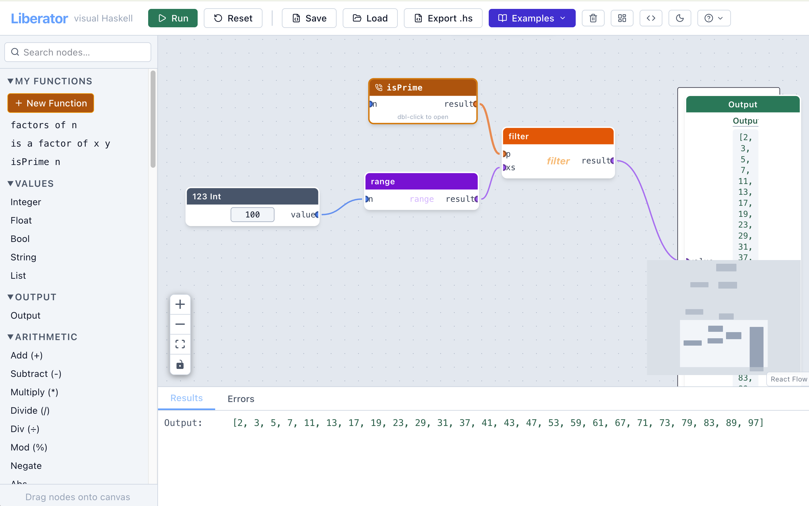
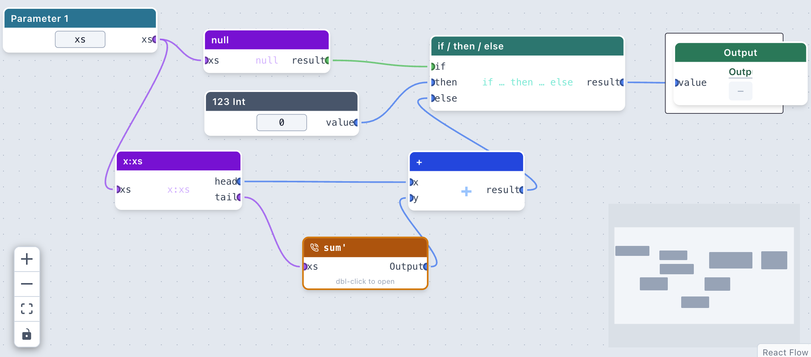
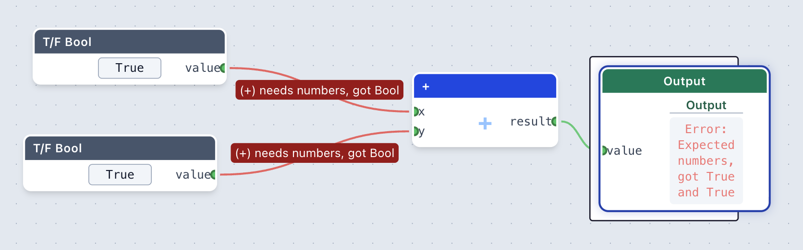

---       

layout: post       
title: "Wiring up functions: Liberator, vibe coding and a room full of maths teachers"       
date: "2026-10-24 12:00:00 +0000"
author: Miles Berry
permalink: /2026/10/liberator/
comments: true
image:
     feature: 261024.jpg
---

# Wiring up functions: Liberator, vibe coding and a room full of maths teachers

My first real programming happened in a maths prep room, on the head of maths' Sharp MZ80K. I've never quite lost the sense that computers are for *doing* mathematics, not just for learning or teaching it. That conviction is behind **Liberator**, a visual environment for programming in Haskell that Claude has built for me this year, which you can try at [milesberry.net/liberator](https://milesberry.net/liberator).

## Why Haskell, and why wires?

Functional programming is part of the AQA A-Level Computer Science specification: function types, first-class and higher-order functions, partial application, composition, and map, filter and fold over lists. AQA rightly takes the view that students should see what a real functional language looks like, and Haskell is the usual choice. But Haskell in school isn't straightforward. The syntax is terse, the error messages can be baffling, and I know of good schools where it simply isn't taught because the network manager won't let it be installed.

There's also a deeper point. Students meet functions in maths long before they meet them in computing, as function machines: something goes in, something comes out, and you can chain machines together. Functional programming is that idea taken seriously. Haskell then adds a layer of unfamiliar notation on top of semantics that are, at heart, the semantics of the function machine.

So: what if you could build Haskell programs by wiring function machines together? This isn't a new idea. Logotron's Numerator, on the Acorn Archimedes, let pupils build functional programs by connecting boxes on screen, and it's very much the inspiration here. Liberator brings that approach to Haskell, in the browser, with nothing to install and no login. Each node is a value or a function; each wire is an argument. Wires are coloured by type, and turn red, with a plain-English explanation, when something doesn't fit. Click Run and every output shows its value. You can define your own functions, including recursive ones, and export the whole thing as Haskell that runs in GHC, so students can see the text version of what they've built.

## How it was built: vibe coding, with a teacher in the loop

I didn't write the code, and I don't claim to have made Liberator: it was built by Claude Code, Anthropic's agentic coding tool. The first commit, on 23 February, scaffolded the app; by the end of that day it had type inference, coloured wires and a working evaluator. It's now around 30 merged pull requests later.

That, for me, is the real interest of vibe coding. Liberator is a niche tool: a visual front end to one programming language, for one part of one A-Level specification. It would never have justified commercial development, and it wouldn't have been a sensible use of my own time to write it either. What vibe coding changes is the economics of tools like this. Someone with a clear idea of what their students need can now have that tool built, rather than make do with whatever the market happens to provide.

"Vibe coding" is the fashionable term, and it fits up to a point: I described what I wanted in plain English, and the AI wrote the React and TypeScript, the evaluator, the type checker and the Haskell export. But it wasn't a matter of typing a wish and accepting whatever came back. The division of labour was quite clear. I decided what Liberator was for, what it should look like, which parts of Haskell mattered for A-Level and which could wait. I tested everything, constantly, and reported what was wrong as precisely as I could. Claude did the implementation, tested its own changes in a browser, and, increasingly, explained the trade-offs before acting.

A few things struck me. The first is that domain knowledge matters more, not less. The AI could implement anything I could describe, but knowing *what* to describe, what a sixth-former needs to see and where Haskell's ideas should show through rather than be smoothed over, was entirely on my side of the table. The second is that the AI is a good tester of its own work when asked. Checking every built-in example's exported Haskell in GHC turned up a bug I'd never have spotted, where one example produced code that ran forever. The third is that saying no is part of the job. When the AI suggested moving function definitions off the canvas into a palette, as Snap! does, I declined: it would have moved Liberator away from Haskell, where a definition is something you can see. The tool is only as good as the judgements of the person steering it.

## BCME10: the power of a room full of teachers

The real test came at BCME10, the British Congress of Mathematics Education, where I ran a session with maths teachers. They built programs, chained function machines, and tried writing recursive functions. They were generous, sharp and honest. Within minutes they'd found the rough edges I'd stopped noticing:

- "What would be nice is if the outputs were all lined up." (They now are.)
- "If I unwrap it, can I then rewrap it?" There was no unwrap, only Ctrl+Z. (There is now, and it turns out to be a lovely way to show substitution: unwrap a call to see the function's body with the arguments plugged in, one step at a time.)
- Recursion was, I had to admit, something Liberator wasn't yet really wired to do well.

The transcript of that session became a to-do list. Over the next few days Claude worked through it, and fifteen changes were merged, among them:

- values shown on every wire after a run, like the intermediate numbers in a function machine;
- calls to your own functions that look like the functions themselves;
- an Apply button that turns any gap inside a function into a new parameter;
- a compose node, so `f . g` sits alongside map and filter;
- a New Function button, so recursive functions can be started from scratch.

Of everything, this is the bit I'd most want other developers of educational software to take away. An afternoon with teachers using the thing was worth more than weeks of my own testing, and an AI collaborator made it possible to act on what they said while it was still fresh.

## Where we are now

Liberator now covers nearly all of the functional programming content in the AQA specification; composition was one of the last gaps. Its type checker understands Haskell's basic type classes, so `True + 1` gets a red wire saying that `+` needs numbers, before you've even pressed Run. The exported Haskell for every built-in example runs in GHC and gives the same answers as Liberator. It's free, it runs in any modern browser, and saving your work is entirely local: nothing you build leaves your machine.

What's next is more of what worked: getting Liberator in front of teachers and students, watching where they get stuck, and fixing that. If you teach A-Level Computer Science, or you're a maths teacher curious about function machines that actually compute, please [give it a try](https://milesberry.net/liberator) and tell me what's wrong with it. On recent evidence, there's a good chance it'll be fixed within the week!

*This post grew out of a talk I gave at BCME10 in Nottingham. The materials are at [bit.ly/BCME10](http://bit.ly/BCME10)*